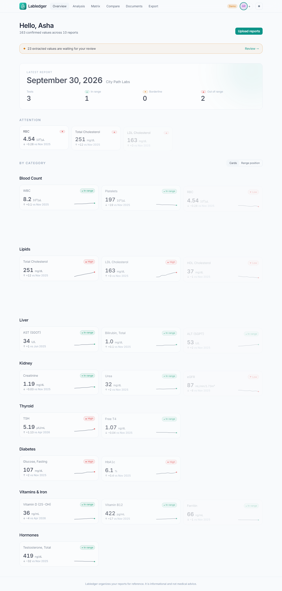
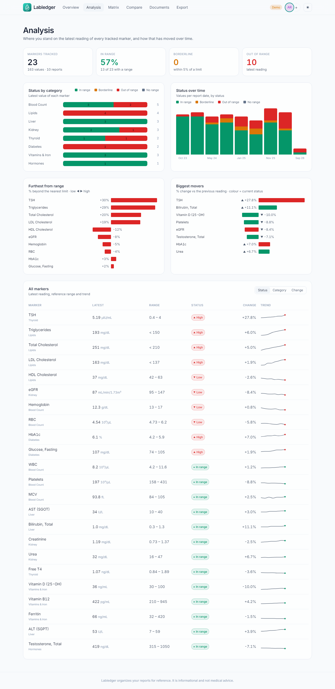
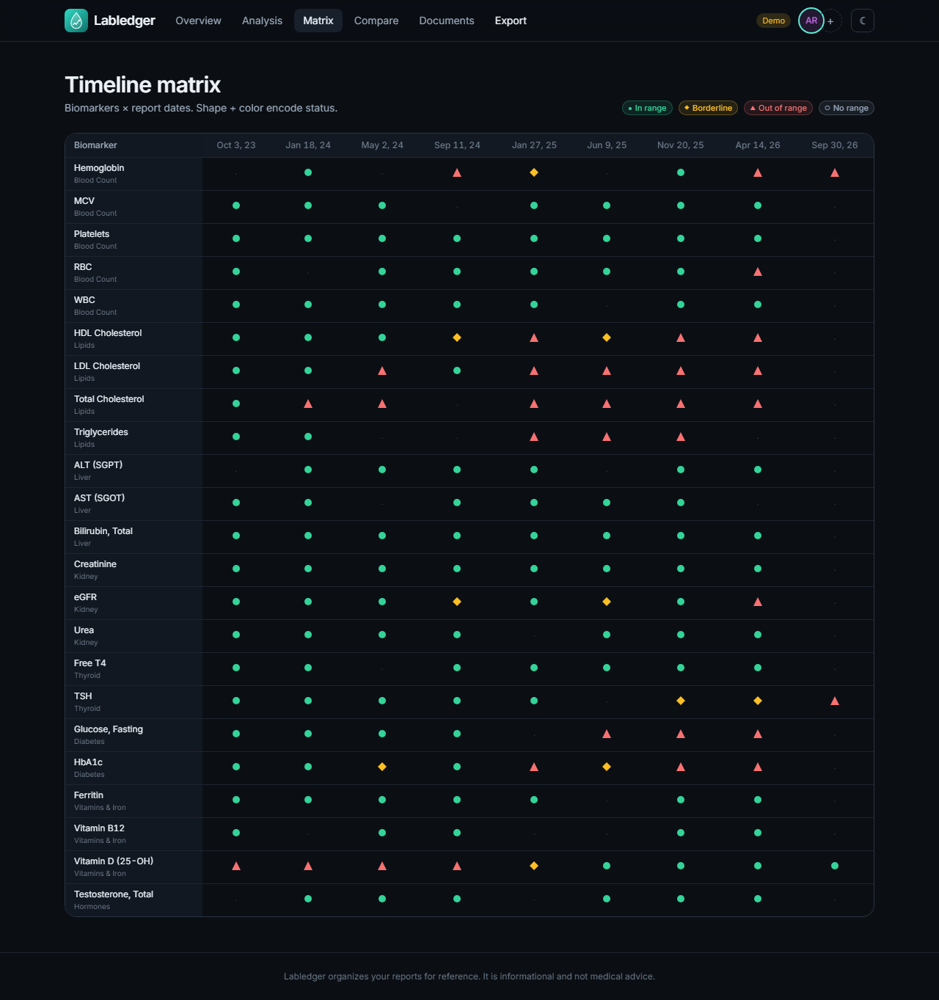
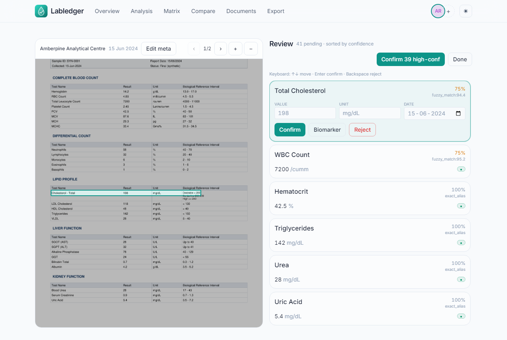
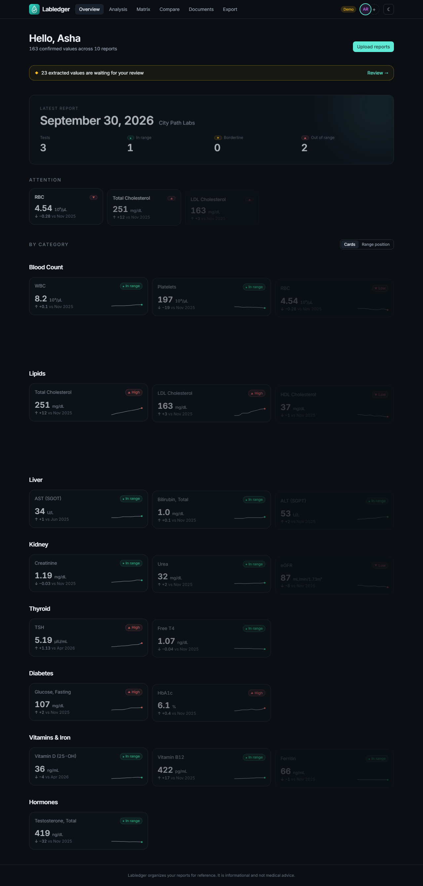
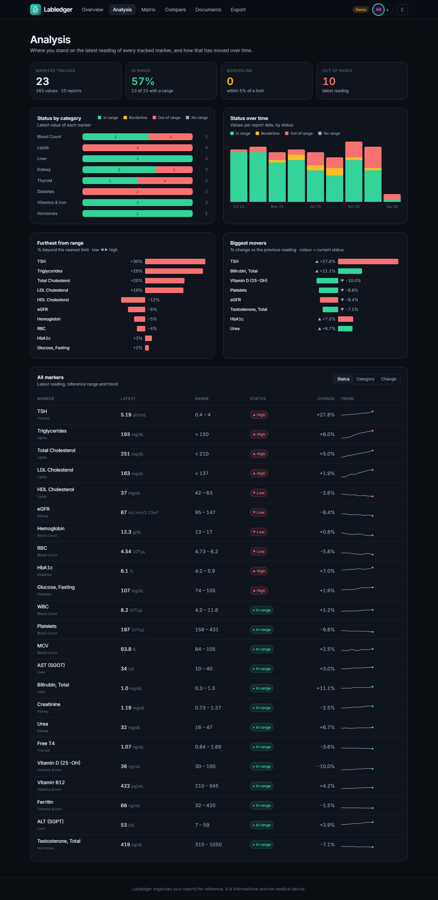
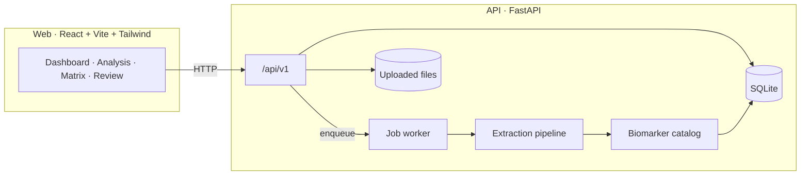

<p align="center">
  
</p>

<h1 align="center">Labledger</h1>

<p align="center">
  <b>Your lab results, tracked over time. Local-first.</b><br>
  Upload pathology reports, verify what was read, and watch every marker trend across years.
</p>

<p align="center">
  <a href="LICENSE"></a>
  
  
  
  
</p>

<p align="center">
  
</p>

Lab reports arrive as PDFs and phone photos, each lab with its own layout, units and reference ranges. Labledger turns them into one longitudinal record you own: values are extracted, normalised to a common unit, flagged against the right range, and **only saved after you confirm them**.

> **Informational only. Not medical advice.** Labledger organises your reports for reference. It does not diagnose, and extracted values can be wrong. Always check the original report and talk to a clinician.

## Features

- **Upload PDFs and images.** Digital PDFs are read directly from their text layer; scans and photos go through OCR (Tesseract).
- **Verify before it counts.** A review screen shows the original page with the extracted value boxed on it. Confirm, edit, reject, or bulk-confirm high-confidence rows. Duplicates for the same day are shown side by side.
- **Understands real-world reports.** 169 biomarkers with Indian and international aliases, unit conversion (mg/dL ⇄ mmol/L, `/cumm` → 10³/µL, lakhs/cumm, g% and more), and reference ranges taken from the report first, falling back to built-in ranges by age and sex.
- **Visual analysis from day one.** Dashboard, status-by-category and status-over-time charts, a "furthest from range" bar chart, biggest movers, a sortable table with sparklines, and a biomarker × date timeline matrix.
- **Per-biomarker trends** with the reference band that applied at each date, a compare view, and CSV / JSON / zip export plus a print-ready report.
- **Multiple profiles** (family members), each kept separate.
- **Private by design.** Binds to `127.0.0.1`, no telemetry, no external network calls, logs contain IDs only, optional passphrase lock.
- **Installable PWA** with dark and light themes, and an offline demo mode (`/?demo=1`).

## Screenshots

| Analysis | Timeline matrix |
|---|---|
|  |  |

| Review (extraction on a real PDF) | Mobile |
|---|---|
|  |  |

<details>
<summary>Dark mode</summary>



</details>

## Quick start

**Requirements:** Python 3.12, Node 20+, GNU make, and [Tesseract](https://tesseract-ocr.github.io/tessdoc/Installation.html) on your `PATH` if you want to read scans and photos (digital PDFs work without it). On Windows, run `make` from Git Bash.

```bash
git clone https://github.com/Garuda8887/labledger.git
cd labledger

make migrate seed-catalog     # creates the venv, database and biomarker catalog
make dev-api                  # API  → http://127.0.0.1:8000  (docs at /docs)

# in a second terminal
make dev-web                  # UI   → http://127.0.0.1:5173
```

Open <http://127.0.0.1:5173>, create a profile and upload a report. Try it with a synthetic one from `api/tests/fixtures/synth/digital/`.

Want to look around first? `make seed-demo` fills three profiles with a year of quarterly reports, or open `/?demo=1` for the UI with built-in data and no API.

### Docker

```bash
make up        # → http://localhost:8080
make down
```

The compose file binds to localhost, persists data in a volume, and installs Tesseract in the API image. It has not been exercised in CI yet, so treat it as a starting point.

## Configuration

All settings are environment variables.

| Variable | Default | Purpose |
|---|---|---|
| `LABLEDGER_DATA_DIR` | `./data` | SQLite database, uploaded files, backups |
| `BIND_HOST` | `127.0.0.1` | Interface to bind. Use `0.0.0.0` only behind TLS and auth |
| `APP_PASSPHRASE` | _unset_ | Enables the passphrase lock (see Security) |
| `SESSION_SECRET` | generated | Cookie signing key. Unset: a random key is created on first run in `$LABLEDGER_DATA_DIR/.session_secret` |
| `COOKIE_SECURE` | auto | Force the cookie `Secure` flag. Auto: on whenever the request is HTTPS or `X-Forwarded-Proto: https` |
| `EXTRACTOR_PLUGIN` | _unset_ | Optional extra extractor, e.g. `ollama` (see below) |
| `MAX_UPLOAD_BYTES` | 50 MiB | Per-file upload limit |
| `BACKUP_KEEP` | `14` | Database backups to retain |

## How it works



1. **Ingest:** upload a PDF or image and a document and job are created.
2. **Extract:** classify as digital or scanned, read the text layer or OCR it, parse the table layout into rows.
3. **Normalise:** match each test name to a biomarker, convert units, parse reference ranges, compute flags, score confidence.
4. **Review:** you confirm, edit or reject each row. Only confirmed rows reach the dashboards and exports.

Extraction is deterministic and rule-based. Optional plugins can only **add** candidate rows, never replace or auto-confirm them.

| Layer | Location |
|---|---|
| API | `api/app/` (FastAPI, SQLAlchemy, Alembic, in-process job worker) |
| Extraction | `api/app/extraction/` |
| Catalog | `api/app/catalog/` (seed JSON, matching, units, conversions, ranges) |
| Web | `web/` |
| Synthetic reports and accuracy harness | `api/app/synth/` |
| JSON Schema contracts | `shared/schemas/` |

## Security

- **Default:** no lock; the server listens on `127.0.0.1` only.
- **Passphrase lock:** set `APP_PASSPHRASE` and every `/api/v1` route (except unlock, status and health) requires a signed, HttpOnly, `SameSite=Lax` session cookie valid for 7 days. This protects a single-user instance; it is **not** multi-user authentication, and all profiles are visible to anyone who unlocks.
- Do not expose Labledger to the internet without a TLS-terminating reverse proxy and your own access control in front of it.
- Uploaded originals are never modified, logs never contain result values or names, and the cloud extractor stub refuses to load.

## Development

```bash
make test          # API tests (pytest) + web typecheck and build
make test-e2e      # Playwright suite (demo mode)
make eval          # extraction accuracy on synthetic reports
make openapi       # regenerate the OpenAPI schema
make backup        # snapshot the database
```

**Add a biomarker or alias:** edit `api/app/catalog/seed/biomarkers.json` and run `make seed-catalog` (idempotent). Confirming an edited row also teaches a runtime alias.

**Add a unit conversion:** edit `api/app/catalog/seed/conversions.json` and run `make seed-catalog`. Built-in ranges live in `builtin_ranges.json`.

**Add a layout test:** define a `LayoutSpec` in `api/app/synth/layouts.py`, run `make generate-synth`, then add an assertion in `api/tests/extraction/` or let `make eval` score it. All fixtures are fictional labs and synthetic patients, so there is no real health data in this repo.

**Optional extractor plugin:** `EXTRACTOR_PLUGIN=ollama` enables a stub for a local vision model (it makes no network calls yet and returns no rows until an adapter is written).

**Backup and restore:** `make backup` writes a timestamped copy to `$LABLEDGER_DATA_DIR/backups/`. To restore, stop the API and copy a backup over `labledger.db`. Each profile can also be exported and re-imported as a portable zip (`GET /api/v1/profiles/{id}/export`, `POST /api/v1/profiles/import`).

## Known limitations

- Digital PDFs extract very well on the synthetic suite, but **photos and scans are much weaker**: rotation, blur and perspective distortion in particular. Confidence is capped for OCR rows so nothing low quality looks certain, and review before saving is mandatory by design.
- Handwritten reports are not supported.
- Duplicate-conflict detection runs in the browser, not on the server.
- Single-user auth only (see Security). Accounts, roles and per-user data isolation are not implemented.

## Contributing

Issues and pull requests are welcome. Please run `make test` first, and keep any new fixtures synthetic.

## Licence

[MIT](LICENSE)
